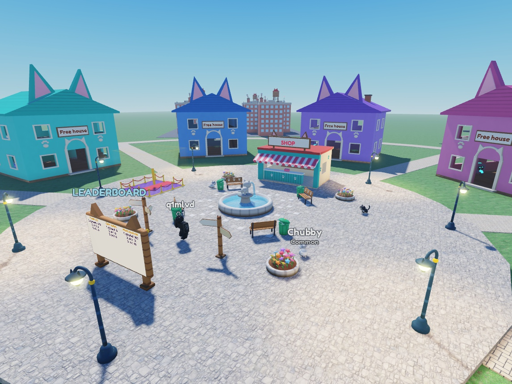
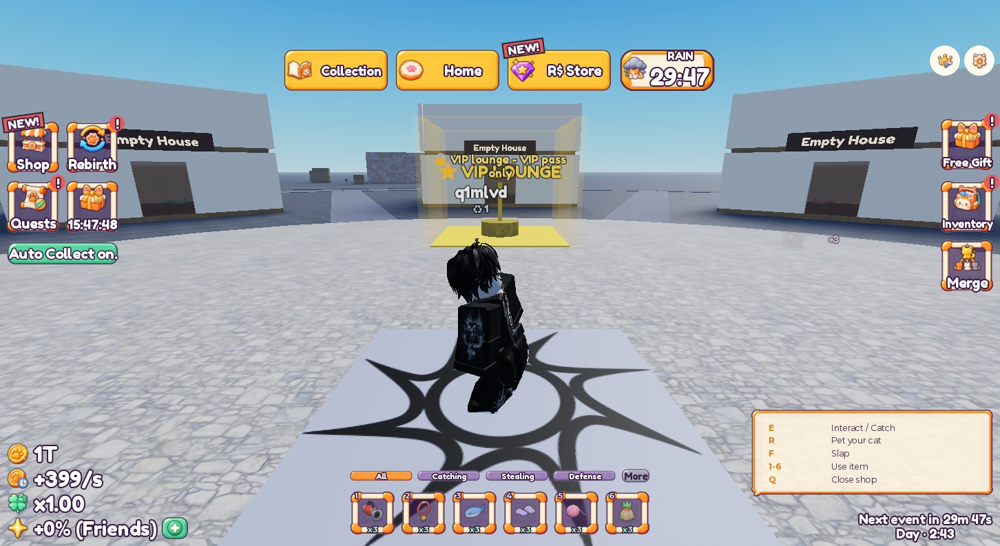
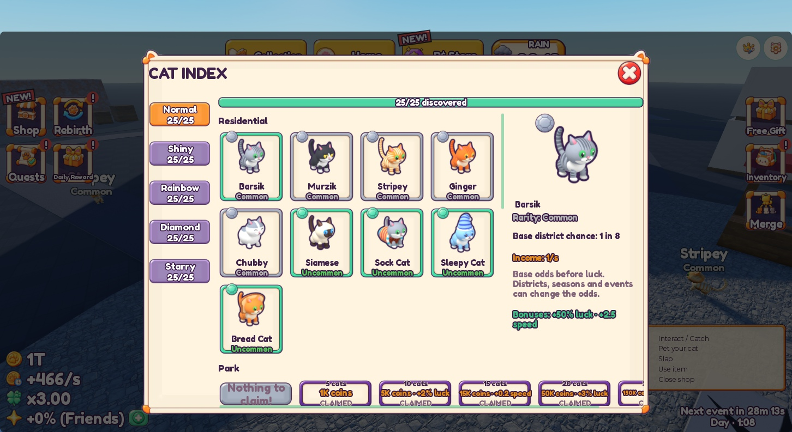
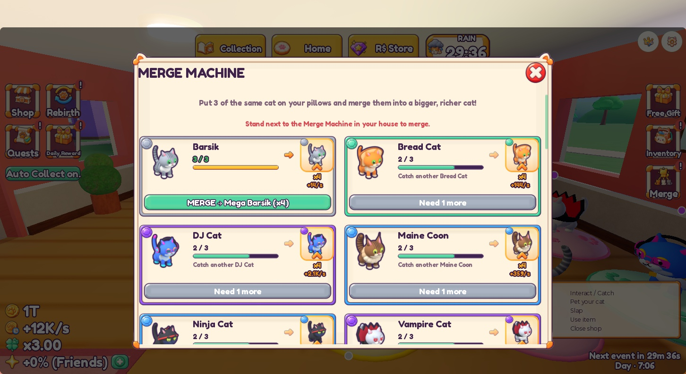
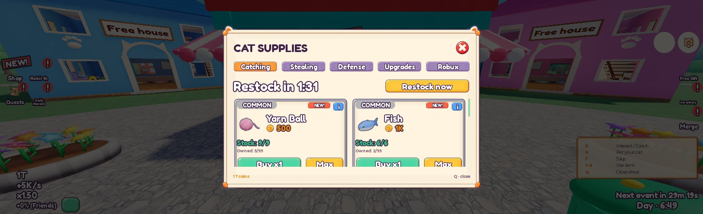
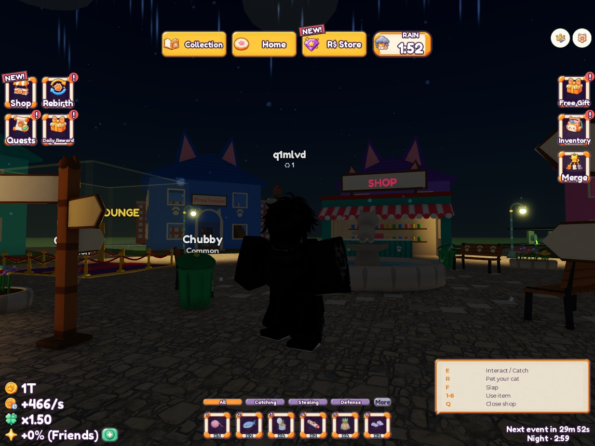
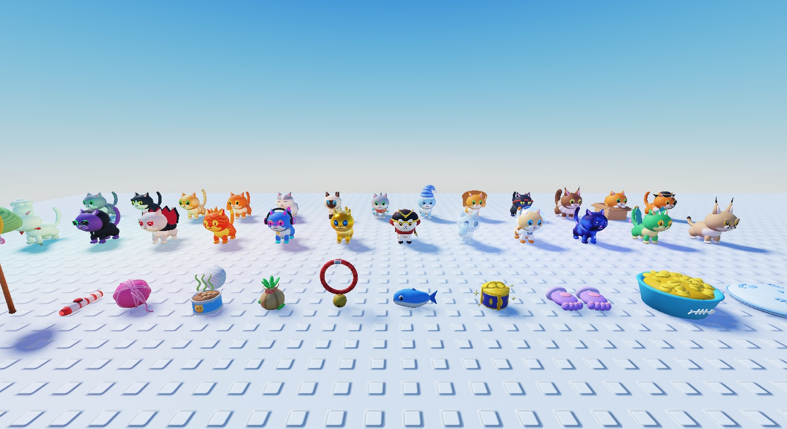

<div align="center">

# 🐱 Steal a Cat

**Roblox-гра: лови котів у районах міста, бережи їх у своєму будинку й викрадай у сусідів.**




</div>

## Про гру

Мультиплеєрний симулятор у жанрі «steal a …». Гравець ловить котів у п'яти районах міста (Residential, Park, Industrial, Rooftops, Sewers), розсаджує їх на подушках у своєму будинку, де вони приносять монети, і може викрадати котів з інших будинків. Від крадіжок захищають двері, пастки та сторожові пси.

Гра пройшла 21 етап розробки: від ядра до безпеки, аналітики та чек-листа запуску.

| HUD | Індекс котів |
|---|---|
|  |  |
| **Машина злиття** | **Магазин із ротацією товарів** |
|  |  |
| **Нічна подія «Дощ»** | **Моделі котів і предметів** |
|  |  |

## Що реалізовано

**Геймплей**
- 🐾 25+ котів, 7 рідкостей, мутації (Shiny, Rainbow, Diamond, Starry), сезонні коти
- 🎯 Міні-гра ловлі, перенесення котів, повернення втікачів додому
- 🏠 Особистий будинок із двома поверхами, подушками, дверима та замком
- 🦹 Крадіжки, ляпаси, щити, пастки й сторожові пси
- ⚗️ Злиття: 3 однакових коти → Mega (x4) → Giga (x20)
- 🔁 Rebirth-система з винагородами, щоденні нагороди, квести, нагороди за час у грі
- 🌧️ Глобальні події: дощ, зорепад, сезонні декорації, зміна дня й ночі

**Монетизація та LiveOps**
- Геймпаси, Developer Products, ексклюзивний магазин, подарунки іншим гравцям
- Магазин із детермінованою ротацією товарів кожні 5 хвилин
- Серверна удача, адмін-панель, рейтинг гравців

**Технічна частина**
- 🛡️ **Безпека**: усі RemoteEvent перевіряються на сервері (сесії, дистанція, cooldown, білі списки), античит на телепорт, швидкість і проходження крізь стіни
- 💾 **Дані**: ProfileStore із сесійним блокуванням, міграції схеми, захист від повторного нарахування покупок
- 📱 **Адаптивний UI**: перевірено на PC, малих і великих телефонах та планшетах, в обох орієнтаціях, touch-цілі ≥ 44 px
- 🌍 **Локалізація** EN/RU через LocalizationTable
- ⚡ **Продуктивність**: StreamingEnabled, режим Low graphics (−31% навантаження на GPU), 60 FPS, без витоків пам'яті за 30 хвилин
- 📊 **Аналітика**: воронка онбордингу на 13 кроків, економічні події, бейджі

## Архітектура

```
src/
├── ReplicatedStorage/Shared/
│   ├── Config/        # 48 конфігів: усі числа гри тут, жодних «магічних чисел» у логіці
│   └── Util/          # Спільні утиліти: UI-скін, локалізація, форматування
├── ServerScriptService/
│   ├── Services/      # 38 серверних сервісів
│   ├── Data/          # Схема даних гравця
│   └── Packages/      # ProfileStore (loleris, MIT)
└── StarterPlayer/StarterPlayerScripts/
    └── Controllers/   # 40 клієнтських контролерів
```

- **Сервіси й контролери** завантажуються одним Loader'ом. Кожен модуль має `Priority`, `Init()` (без yield) і `Start()` (у власному потоці)
- **Один список мереж**: `Config/RemoteDefinitions`, тобто всі RemoteEvent/RemoteFunction оголошені в одному місці
- **Сервер вирішує все**: клієнт лише надсилає наміри, сервер перевіряє їх і змінює стан

> У репозиторії лежить знімок коду на етапі 17.6. Наступні етапи (безпека, аналітика, бейджі) додали ще 3 сервіси й 8 контролерів.

## Технології

`Luau (--!strict)` · `Roblox Studio` · `ProfileStore` · `DataStoreService` · `MarketplaceService` · `LocalizationService` · `AnalyticsService` · `Blender (3D-моделі)`
